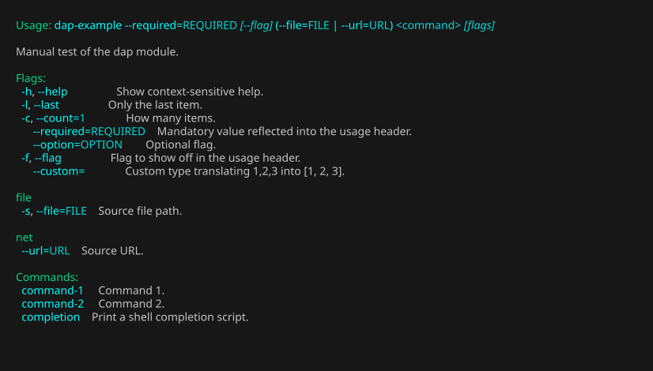

# dap

Declarative command-line parser for Zig (0.17.0).



You declare the command line once, as a struct literal. `dap.generate` turns that declaration into a parser and a typed
`View` at compile time, so names, types, defaults and validation are checked by the compiler rather than at runtime.

<!-- BEGIN mktoc -->

- [dap](#dap)
- [Install](#install)
- [A flat CLI](#a-flat-cli)
- [A commanded CLI](#a-commanded-cli)
- [Capabilities](#capabilities)
- [Building and testing](#building-and-testing)

<!-- END mktoc -->

## Install

Add this package as a dependency named `dap`, then import the module into the executable:

```zig
const dap = @import("dap");
```

The `build.zig` wiring, the generated namespace and its full contract are in
[AGENTS-SDK.md §1](./AGENTS-SDK.md#1-module-wiring) and [§2](./AGENTS-SDK.md#2-generated-namespace).

## A flat CLI

A download tool with a `-l/--login` option that falls back to `$USER`, a checked integer option, a required file
argument, and the always-present `--help`:

```zig
const std = @import("std");
const dap = @import("dap");

const def = .{
    .login = dap.Flag([]const u8){
        .short = "l",
        .default = dap.Default(dap.String){ .env = "USER" },
        .validation = dap.Validate.stringNotEmpty,
        .help = "User login.",
    },
    .level = dap.Flag(u8){
        .short = "L",
        .default = dap.defaultValue(u8, 1),
        .validation = dap.Validate.intNotZero(u8),
        .help = "Verbosity level.",
    },
    .path = dap.Argument([]const u8){
        .validation = dap.Validate.stringNotEmpty,
        .help = "Path of the file to download.",
    },
};

const CLI = dap.generate(
    dap.App{ .name = "api-downloader", .help = "Download a file from the API." },
    def,
);

pub fn main(init: std.process.Init) !void {
    const arena = init.arena.allocator();
    const argv = try init.minimal.args.toSlice(arena);

    var diag: dap.Diag = .{};
    defer diag.deinit(arena);

    // `argv[1..]` is pure payload: no binary name, no skipped token.
    const cli = try CLI.parse(arena, init.minimal.environ, argv[1..], &diag);

    std.debug.print("{s} level={d} {s}\n", .{ cli.login, cli.level, cli.path });
}
```

```sh
$ api-downloader -l alice report.json
$ api-downloader --help
```

`CLI.View` mirrors the declaration: `cli.login` is a `[]const u8`, `cli.level` a `u8`, `cli.path` a `[]const u8`, each
already decoded and validated. A bad value prints a diagnostic plus the relevant help page to stderr and exits non-zero;
`-h`/`--help` prints help and exits cleanly. A successful parse returns a `View` you own, and an arena frees it in one
go.

## A commanded CLI

A workspace tool with global flags, two verbs, a nested command, and a hidden `completion` command that prints a shell
script generated from the same declaration:

```zig
const std = @import("std");
const dap = @import("dap");

const def = .{
    .verbose = dap.Flag(bool){ .short = "v", .help = "Print extra detail." },
    .build = dap.Command(.{ .help = "Compile the project." }, .{
        .jobs = dap.Flag(u8){ .short = "j", .default = dap.defaultValue(u8, 1), .help = "Parallel jobs." },
        .release = dap.Flag(bool){ .short = "r", .help = "Optimize for speed." },
    }),
    .serve = dap.Command(.{ .help = "Run the development server." }, .{
        .addr = dap.Flag([]const u8){ .help = "Listen address." },
        .watch = dap.Command(.{ .help = "Rebuild on change." }, .{}),
    }),
    .completion = dap.Command(.{ .help = "Print a completion script." }, .{
        .shell = dap.Argument(dap.Completion.ShellType){ .help = "Target shell." },
    }),
};

const CLI = dap.generate(
    dap.App{ .name = "workspace", .help = "Build and run the project." },
    def,
);

pub fn main(init: std.process.Init) !void {
    const arena = init.arena.allocator();
    const argv = try init.minimal.args.toSlice(arena);

    var diag: dap.Diag = .{};
    defer diag.deinit(arena);

    var cli = try CLI.parse(arena, init.minimal.environ, argv[1..], &diag);
    defer CLI.deinit(&cli, arena);

    if (CLI.command(cli)) |cmd| switch (cmd) {
        .completion => |c| {
            try CLI.completion(arena, "workspace", switch (c.shell.view) {
                .bash => .bash,
                .zsh => .zsh,
                .fish => .fish,
            }).show(init.io);
            return;
        },
        .build => |b| std.debug.print("build jobs={d} release={}\n", .{ b.jobs, b.release }),
        .serve => |s| std.debug.print("serve {s}\n", .{s.addr}),
    } else {
        try CLI.usage(cli);
    }

    if (cli.verbose) std.debug.print("verbose on\n", .{});
}
```

```sh
$ workspace --verbose build --release --jobs 4
$ workspace serve --addr :8080 watch
$ workspace completion zsh
$ workspace serve --help
```

The `switch` tags are the declaration field names, not the wire names. Flags are addressable anywhere on the command
line: `workspace serve --verbose --addr :8080` assigns `--verbose` to the root `View`, so long and short names are
globally unique across the whole tree and the compiler enforces it. Commands nest, and `CLI.command` accepts a `View`
from any level, so dispatch can go as deep as the declaration does.

Help follows the entered path: `workspace serve --help` describes `serve` with the root flags merged in, and a failure
deep in the tree renders that level's page. `CLI.usage(cli)` prints the same page, which is useful when no command was
given. Completion is generated from the declaration; `CLI.completion(allocator, app_name, shell)` is lazy, and
`app_name` is the name the script registers, not `App.name`. The route it serves for dynamic values runs at the very
start of `CLI.parse`, so do file, socket or network work only after parsing.

## Capabilities

Everything below is specified in detail in [AGENTS-SDK.md](./AGENTS-SDK.md).

| Capability          | What you get                                                                                              | Reference                                                  |
| ------------------- | --------------------------------------------------------------------------------------------------------- | ---------------------------------------------------------- |
| Flags and arguments | `Flag(T)` and `Argument(T)`, verbatim wire names, short aliases, requiredness derived from defaults       | [§3.1–3.3](./AGENTS-SDK.md#31-names-and-requirements)      |
| Defaults            | environment fallback, direct defaults, `dap.defaultValue`; precedence `argv > env > direct > zero`        | [§3.4](./AGENTS-SDK.md#34-defaultt-and-defaultvalue)       |
| Optional flags      | `?T` view fields so "absent" differs from zero; no defaults, no optional arguments                        | [§3.5](./AGENTS-SDK.md#35-optional-flags)                  |
| Help grouping       | `Group` sections and headings, flat view fields                                                           | [§3.6](./AGENTS-SDK.md#36-groupdef-name)                   |
| Alternatives        | `Alt` branches with typed nullable unions, `VariantNamed` tags, conflict detection                        | [§3.7](./AGENTS-SDK.md#37-alt-and-variantnamed)            |
| Subcommands         | nested `Command`, synonyms, typed dispatch via `CLI.command`, global flag names, `--` terminator          | [§3.8](./AGENTS-SDK.md#38-commandmeta-def-and-commandmeta) |
| Composition         | `Compose.shift` prefixing and short-name stripping, `Compose.concat` merging, compile-time clashes        | [§3.9](./AGENTS-SDK.md#39-composition)                     |
| Value types         | builtin integers, floats and strings, plus any type with `decode`/`encode`/`deinit`                       | [§4](./AGENTS-SDK.md#4-value-types)                        |
| Enumerations        | fixed wire-name sets via `Enumeration`, per-value help, completion candidates                             | [§4.3](./AGENTS-SDK.md#43-enumerationt-and-enum)           |
| Validation          | `Validate.stringNotEmpty`, `Validate.intNotZero`, custom validators over wire, env and default values     | [§10](./AGENTS-SDK.md#10-validation)                       |
| Diagnostics         | `Diag` messages, offending token and field, Levenshtein typo suggestions, failure exit behavior           | [§7](./AGENTS-SDK.md#7-errors-and-diagnostics)             |
| Help rendering      | compact two-column page, `HelpData` model, custom renderers, highlight schemes, context-sensitive `usage` | [§8](./AGENTS-SDK.md#8-help)                               |
| Shell completion    | bash/zsh/fish scripts, install targets, static candidates, argument values                                | [§9](./AGENTS-SDK.md#9-completion)                         |
| Predictors          | native file fallback, `fs`, `disabled`, `launch`, `call`, `custom` callbacks through the hidden route     | [§9.2](./AGENTS-SDK.md#92-predictors)                      |
| Ownership           | `CLI.deinit` releases strings, custom values, the active `Alt` branch and nested views                    | [§11](./AGENTS-SDK.md#11-ownership)                        |
| Compile-time checks | declaration errors, duplicate names, global flag uniqueness, structural constraints                       | [§12](./AGENTS-SDK.md#12-compile-time-constraints)         |

## Building and testing

```sh
zig build                  # compile the module and the example
zig build test             # unit tests for the core and composition
zig build completion-test  # opt-in: generated scripts in real shells
zig build run -- --help
```

`completion-test` is opt-in and never runs as part of `zig build test`; a missing shell is reported and skipped.
